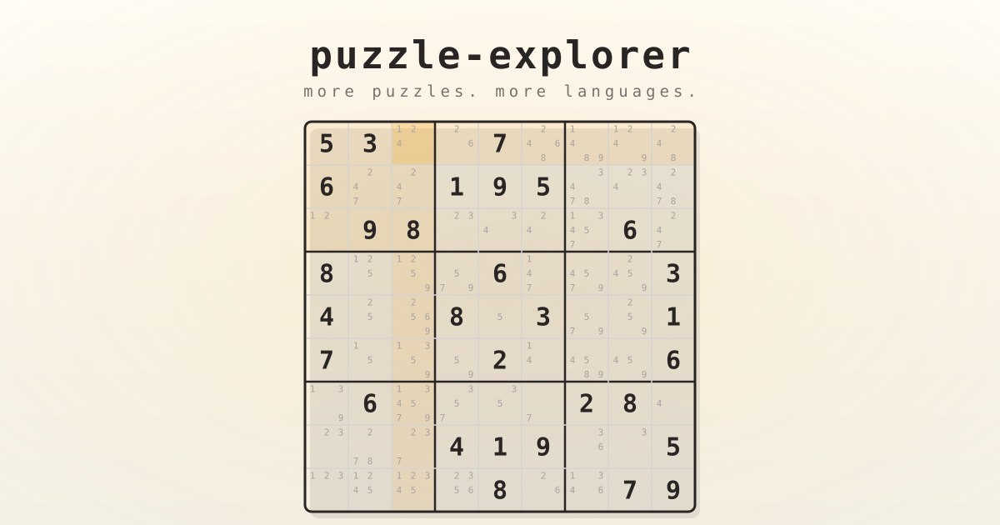

# puzzle-explorer



**More puzzles. More languages. Zero mercy.**

puzzle-explorer starts with the **classic sudoku** — 81 cells, one solution —
and grows from there: more puzzle types, and the same puzzles re-implemented
in more languages, as a Rosetta stone for learning how each language
approaches the same problem. Today that means two implementations side by
side, held to identical behavior by golden parity fixtures: **Racket**
(`sudoku/`) and **Rust + egui** (`rust/`).

## Quick start

Play in the native GUI:

```
racket sudoku/main.rkt ui
```

Or stay in the terminal — generate a fresh puzzle, solve one, or grade one
(difficulty targets: easy 40, medium 32, hard 26 givens, always unique):

```
racket sudoku/main.rkt generate hard
racket sudoku/main.rkt solve   "530070000600195000098000060800060003400803001700020006060000280000419005000080079"
racket sudoku/main.rkt analyze "530070000600195000098000060800060003400803001700020006060000280000419005000080079"
```

Puzzle strings are 81 characters, row-major, `0` (or `.`) for an empty cell.
The Rust app has the same subcommands: `cd rust && cargo run -- ui`.

## Read more

- [Playing the GUI](docs/playing.md) — controls, pencils, heat overlay, live analysis panel, and the puzzle-string format with puzzle → solution boards.
- [Solving and measuring difficulty](docs/solving.md) — constraint propagation, MRV backtracking, uniqueness checks, the complexity metrics behind `analyze`, and sample output.
- [Implementations, layout, and tests](docs/implementations.md) — the Racket and Rust workspaces, requirements, parity fixtures, and how to run the test suites.
- [GLOSSARY.md](GLOSSARY.md) — the shared vocabulary used across code, docs, and the issue tracker.
