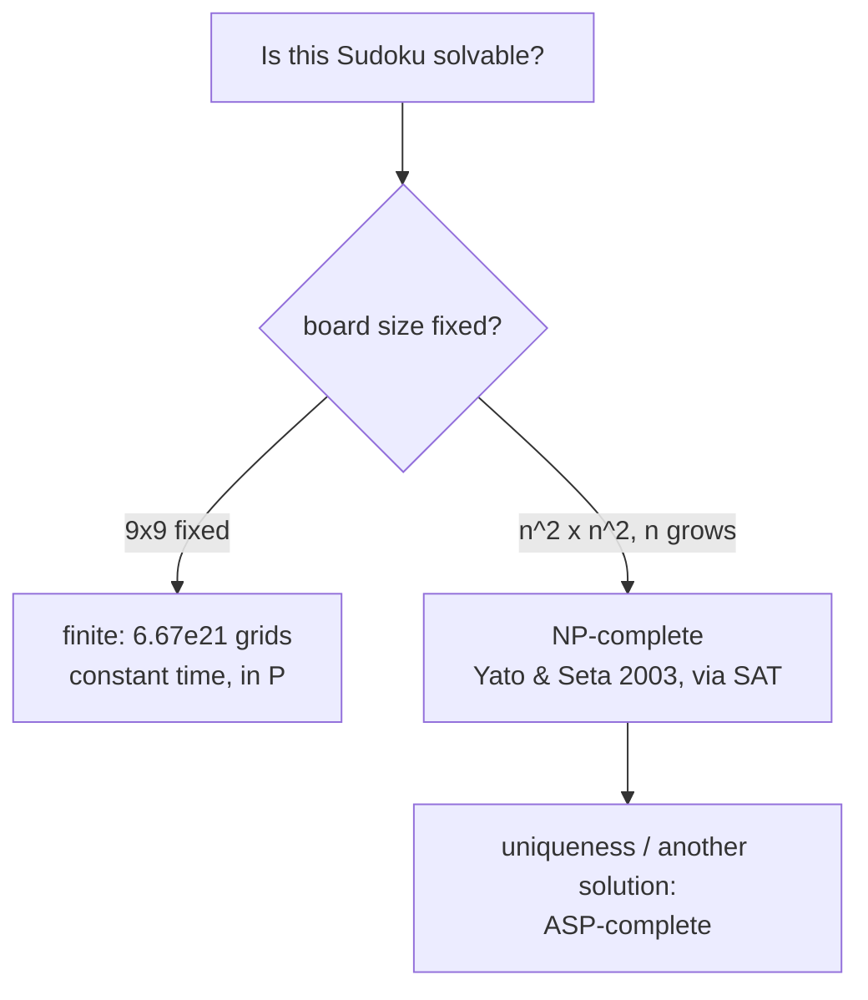
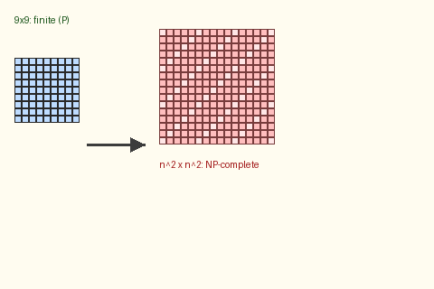

# Is Sudoku NP-complete?

## TL;DR

**Yes — but only in the generalized form.** Deciding whether a partially filled
n^2 x n^2 Sudoku grid (n part of the input) has a solution is **NP-complete**
(Yato & Seta 2003, reducing SAT to it). The classic 9x9 game is a *finite*
problem — 6.67 x 10^21 possible grids — so a fixed 9x9 puzzle is solvable in
constant time and "9x9 Sudoku is NP-complete" is technically false. Related:
asking whether a puzzle has a *second* solution (uniqueness, which generators
must answer) is complete for the **ASP** class — NP-hard in general.

## Deep dive

Three results, three different questions:

1. **Solvability, generalized board: NP-complete.** Yato & Seta (2003) showed
   SAT reduces to "Number Place" (generalized Sudoku) on n^2 x n^2 grids, so
   the decision problem is NP-hard; a completed grid is a polynomial-size
   certificate, so it's in NP — hence NP-complete. This builds on Colbourn's
   1984 result that completing a partial Latin square is NP-complete; a Sudoku
   grid is a Latin square with extra box constraints.
2. **Uniqueness ("another solution"), generalized board: ASP-complete.** The
   same paper proves the another-solution problem ASP-complete. This is the
   check puzzle generators run after every clue removal (capped at 2
   solutions — see [generation.md](generation.md)).
3. **Fixed 9x9: finite, hence trivial for complexity theory.** There are
   exactly 6,670,903,752,021,072,936,960 valid completed 9x9 grids
   (Felgenhauer & Jarvis 2005), so a lookup table solves any 9x9 instance in
   constant time. Complexity classes only bite as the board grows (16x16,
   25x25, ...). For 9x9, the interesting question is practical speed, not
   asymptotics — see [solvers.md](solvers.md).

## Complexity callout

| Question | Fixed 9x9 | Generalized n^2 x n^2 |
|---|---|---|
| Does a solution exist? | constant time (finite) | **NP-complete** |
| Is the solution unique? (another solution) | constant time (finite) | **ASP-complete** (NP-hard) |
| Minimum clues for uniqueness | 17 (exhaustive proof) | open in general |

## Diagram

Alt text: decision flowchart — fixed 9x9 Sudoku solvability is constant-time; generalized n-squared-by-n-squared Sudoku is NP-complete, with the uniqueness question ASP-complete.

## Worked example

The same puzzle string means different things at different sizes. The 81-char
puzzle `530070000...` is one finite instance: a solver answers it in
milliseconds and a precomputed table could answer it instantly. But a family of
instances on 9x9, 16x16, 25x25, ... grids with the size given in the input is a
single infinite problem — and *that* problem is NP-complete, because you can
encode arbitrary SAT formulas as Sudoku grids of growing size (Yato & Seta's
reduction).

## Goofy image

Size is the whole ballgame — `assets/complexity-size.png`.

## See the code

- Uniqueness check (the ASP question in practice): [../sudoku/solver.rkt](../sudoku/solver.rkt) (`count-solutions` with cap), gallery [../sudoku/solvers.rkt](../sudoku/solvers.rkt)
- Search-effort metrics that stand in for asymptotics on 9x9: [../sudoku/complexity.rkt](../sudoku/complexity.rkt) (`analyze`, `difficulty-score`), [../rust/core/src/complexity.rs](../rust/core/src/complexity.rs)
- Solver comparison: [solvers.md](solvers.md)

## Further reading

- Yato, T. & Seta, T. (2003). "Complexity and Completeness of Finding Another Solution and Its Application to Puzzles." *IEICE Transactions on Fundamentals*, E86-A(5), 1052-1060. https://doi.org/10.1587/e86-a_5_1052 — generalized n^2 x n^2 Sudoku is NP-complete (SAT is reduced to it), and the "another solution" problem of Sudoku is ASP-complete, so uniqueness checking is NP-hard in general.
- Colbourn, C. J. (1984). "The complexity of completing partial Latin squares." *Discrete Applied Mathematics*, 8(1), 25-30. https://doi.org/10.1016/0166-218X(84)90075-1 — the earlier NP-completeness proof for partial Latin squares, of which Sudoku is a constrained special case.
- Felgenhauer, B. & Jarvis, F. (2005). "Mathematics of Sudoku I." *The Mathematical Gazette*, 89(516), 499-510. https://doi.org/10.1017/S0025556305003767 — there are exactly 6,670,903,752,021,072,936,960 valid 9x9 grids (about 6.67 x 10^21), so fixed-size 9x9 Sudoku is a finite problem, solvable in constant time.
- McGuire, G., Tugemann, B. & Civario, G. (2014). "There is no 16-Clue Sudoku: Solving the Sudoku Minimum Number of Clues Problem via Hitting Set Enumeration." *Experimental Mathematics*, 23(2), 190-217. https://doi.org/10.1080/10586458.2013.870056 (arXiv:1201.0749) — exhaustive search proves no 16-clue puzzle has a unique solution; the minimum is 17 clues.
