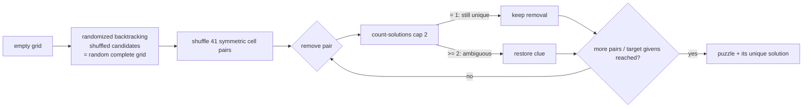
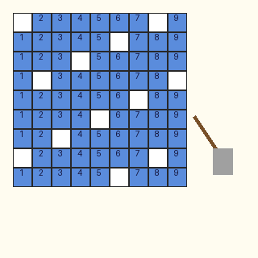

# How do you generate a Sudoku puzzle with exactly one solution?

## TL;DR

Two phases: (1) build a **random complete grid** by backtracking with shuffled
candidate order (randomized DLX is the fast way), then (2) **remove clues** —
in symmetric pairs — and after every removal re-check that the puzzle still has
a **unique solution** (count solutions with early exit at 2), restoring the
clue if it doesn't. Difficulty is steered by how many givens remain: this repo
targets easy 40 / medium 32 / hard 26.

## Deep dive

A solved grid is easy to randomize; a *puzzle* is the hard part, because
"remove clues until it looks hard" usually breaks uniqueness. The pipeline in
`sudoku/generator.rkt` (and `rust/core/src/generator.rs`) is:

1. **Complete-grid generation** (`generate-complete-grid`): fill cells 0-80
   with a shuffled candidate list by backtracking; on dead end, undo and try
   the next digit. Every complete grid is equally reachable, and there are
   6.67 x 10^21 of them (Felgenhauer & Jarvis 2005).
2. **Clue removal** (`remove-clues`): walk the 41 symmetric cell pairs in a
   shuffled order; tentatively empty each cell (or pair) and keep the removal
   only if `count-solutions puzzle 2` still returns 1. Ten shuffled attempts are
   tried and the one with the fewest givens wins.

The uniqueness check is the load-bearing step: `count-solutions` with cap 2
stops as soon as a second solution appears, which is exactly the
"another solution problem" — cheap in practice for 9x9, hard in general (see
the callout below).

## Complexity callout

Deciding whether a generalized n^2 x n^2 Sudoku has a solution is NP-complete,
and deciding whether it has a *second* solution (uniqueness) is complete for
the ASP class (Yato & Seta 2003) — see [complexity.md](complexity.md). For a
fixed 9x9 board everything is finite and our capped counting is fast. Also
relevant: a unique 9x9 puzzle needs at least **17 clues** — proven by
exhaustive search (McGuire, Tugemann & Civario 2014, arXiv:1201.0749).

## Diagram

Alt text: generation pipeline — random complete grid, then symmetric-pair clue removal where each removal is kept only if the solution count stays at 1.

## Worked example

From a random complete grid, removing a symmetric pair (e.g. cells 0 and 80)
is checked with `count-solutions puzzle 2`: if the count becomes 2, the pair
is restored. Repeating this down to the difficulty target (easy 40, medium 32,
hard 26 givens) yields a proper puzzle plus the solution it was carved from.
Run it yourself: `racket sudoku/main.rkt generate hard`.

## Goofy image

A complete grid with holes being dug out — `assets/generation-dig.png`.

## See the code

- Racket: [../sudoku/generator.rkt](../sudoku/generator.rkt) — `generate-complete-grid`, `remove-clues`, `generate-puzzle`, `difficulty-givens`
- Rust: [../rust/core/src/generator.rs](../rust/core/src/generator.rs)
- Uniqueness check used during removal: [../sudoku/solvers.rkt](../sudoku/solvers.rkt) (`count-solutions-with`, cap 2), production [../sudoku/solver.rkt](../sudoku/solver.rkt) (`count-solutions`)
- CLI: [../sudoku/main.rkt](../sudoku/main.rkt) (`generate easy|medium|hard`)

## Further reading

- Knuth, D. E. (2000). "Dancing Links." arXiv:cs/0011047 — https://arxiv.org/abs/cs/0011047 — randomized Algorithm X is the standard fast way to enumerate/generate complete grids.
- McGuire, G., Tugemann, B. & Civario, G. (2014). "There is no 16-Clue Sudoku." *Experimental Mathematics* 23(2), 190-217. https://doi.org/10.1080/10586458.2013.870056 (arXiv:1201.0749) — the 17-clue minimum, proved with solution counting.
- Felgenhauer, B. & Jarvis, F. (2005). "Mathematics of Sudoku I." *The Mathematical Gazette* 89(516), 499-510. https://doi.org/10.1017/S0025556305003767 — the 6.67 x 10^21 complete grids.
