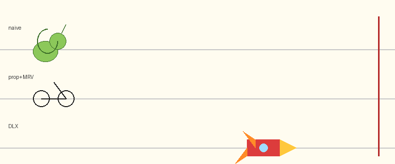

# Which Sudoku-solving algorithm is fastest — and how do the three in this repo compare?

## TL;DR

For a standard 9x9 puzzle, **DLX (Knuth's Algorithm X with Dancing Links over the
exact-cover matrix) is the fastest of the three solvers in this repo** — around
0.4-0.7 ms average per puzzle on our benchmarks, versus ~16 ms for the
production propagation + MRV solver on hard puzzles and *seconds to minutes*
for naive backtracking. All three always find the same solution; they differ
only in how much of the search tree they explore.

## Deep dive

A solver gets a partially filled 9x9 grid and must find a completion (or
prove none exists). All three solvers here are **complete** — they never miss
a solution — but they search very differently:

- **Naive backtracking** (`sudoku/solvers/naive.rkt`,
  `rust/core/src/solvers/naive.rs`): scan cells 0-80 in order, try digits 1-9
  in order, undo on dead end. No pruning beyond "does this digit conflict with
  a peer". Simple, but it re-explores huge swaths of the tree.
- **Constraint propagation + MRV** (`sudoku/solver.rkt`,
  `rust/core/src/solver.rs`, exposed in the gallery as
  `sudoku/solvers/propagation-mrv.rkt`): first fill every *forced* cell
  (naked singles and hidden singles) until fixpoint, then branch on the empty
  cell with the **fewest candidates** (MRV = minimum remaining values). This is
  the production solver of the app.
- **DLX / Algorithm X** (`sudoku/solvers/dlx.rkt`,
  `rust/core/src/solvers/dlx.rs`): Sudoku is rewritten as an **exact cover**
  problem — 729 candidate placements (row, column, digit) against 324
  constraint columns (cell / row-digit / column-digit / box-digit) — and solved
  by Algorithm X with Dancing Links, whose O(1) cover/uncover makes backtracking
  nearly free; branching on the minimum-size column is MRV over constraints
  (Knuth, arXiv:cs/0011047).

The gallery registry (`sudoku/solvers.rkt` → `all-solvers`,
`rust/core/src/solvers/mod.rs` → `all_solvers()`) exposes all three behind one
solver contract (`solve` / `solve-with-stats` / `count-solutions`), which is
what the benchmark harness iterates.

## Complexity callout

For a *fixed* 9x9 board, solving is a finite problem — there are only
6.67 x 10^21 grids — so any complete solver runs in constant time and the
question "is 9x9 Sudoku NP-hard?" is technically no. But when the grid size
n^2 x n^2 is part of the input, deciding solvability is **NP-complete** — see
[complexity.md](complexity.md). Practically: all three solvers are exponential
in the worst case; the differences are in the constants, and DLX's are tiny.

## Diagram

```mermaid
flowchart LR
    P[Puzzle grid] --> N[naive backtracking<br/>cells 0-80, digits 1-9, in order]
    P --> M[propagation + MRV<br/>singles to fixpoint, then fewest-candidates cell]
    P --> D[DLX / Algorithm X<br/>729x324 exact cover, min-size column, O(1) cover/uncover]
    N --> S[Solution]
    M --> S
    D --> S
```

Alt text: flowchart of the three gallery solvers — naive backtracking, propagation plus MRV, and DLX exact cover — all taking a puzzle grid and returning a solution.

## Worked example

The README puzzle
`530070000600195000098000060800060003400803001700020006060000280000419005000080079`
benchmarked with 1 warmup + 5 timed runs per solver (Racket harness,
`docs/assets/benchmark-results.csv`):

| solver | nodes | max depth | median wall ms |
|---|---|---|---|
| naive | 4,209 | 51 | ~39 |
| propagation-mrv | 52 | 51 | ~3 |
| dlx | 52 | 51 | ~0.3 (2,646 link updates) |

And the extreme case, Norvig's "grid2" (also `bench-extremes.txt` #2): naive
needs **9,727,397 nodes (~35 s)**, propagation+MRV 482 nodes (~32 ms), DLX
118 nodes (~0.4 ms). Same solution, wildly different search.

Full results (avg / p95 / max wall ms, avg nodes, DLX link updates per fixture
set — Norvig's top95 hard set, a 2,000-puzzle prefix of Royle's 49,151 17-clue
collection, and the named extremes):

| fixture set | solver | puzzles | avg wall ms | p95 wall ms | max wall ms | avg nodes | max depth | avg link updates |
|---|---|---|---|---|---|---|---|---|
| extremes | dlx | 3 | 0.364 | 0.399 | 0.399 | 105.3 | 64 | 4288 |
| extremes | naive | 3 | 11523.436 | 34504.358 | 34504.358 | 3246858.7 | 64 | 0 |
| extremes | propagation-mrv | 3 | 15.967 | 31.879 | 31.879 | 250.7 | 64 | 0 |
| royle17 | dlx | 2000 | 0.349 | 0.610 | 1.331 | 83.5 | 64 | 3672 |
| royle17 | naive | 1 | 134589.202 | 134589.202 | 134589.202 | 41678691.0 | 64 | 0 |
| royle17 | propagation-mrv | 52 | 1434.224 | 6131.084 | 12007.268 | 20233.4 | 64 | 0 |
| top95 | dlx | 94 | 0.716 | 1.479 | 2.715 | 369.0 | 64 | 12257 |
| top95 | naive | 2 | 5845.640 | 11417.739 | 11417.739 | 1670962.5 | 64 | 0 |
| top95 | propagation-mrv | 8 | 5148.710 | 18629.334 | 18629.334 | 73189.5 | 64 | 0 |

Raw per-run rows: [assets/benchmark-results.csv](assets/benchmark-results.csv).
Coverage note: naive costs minutes per 17-clue-class puzzle, so its rows cover
small labeled prefixes of the hard sets; DLX covers top95 fully and a 2,000
puzzle Royle prefix. Every solver's solution was validated identical across
solvers for all 2,097 benchmarked puzzle-solves.



## Goofy image

The race above, drawn to scale of our benchmark: `assets/solvers-race.png`.

## See the code

- Racket gallery: [../sudoku/solvers.rkt](../sudoku/solvers.rkt) (registry + dispatch),
  [../sudoku/solvers/naive.rkt](../sudoku/solvers/naive.rkt),
  [../sudoku/solvers/propagation-mrv.rkt](../sudoku/solvers/propagation-mrv.rkt),
  [../sudoku/solvers/dlx.rkt](../sudoku/solvers/dlx.rkt)
- Rust gallery: [../rust/core/src/solvers/mod.rs](../rust/core/src/solvers/mod.rs),
  [../rust/core/src/solvers/dlx.rs](../rust/core/src/solvers/dlx.rs),
  [../rust/core/src/solvers/naive.rs](../rust/core/src/solvers/naive.rs),
  [../rust/core/src/solvers/propagation_mrv.rs](../rust/core/src/solvers/propagation_mrv.rs)
- Production solver (untouched): [../sudoku/solver.rkt](../sudoku/solver.rkt), [../rust/core/src/solver.rs](../rust/core/src/solver.rs)
- Benchmark harness: [../sudoku/solvers/benchmark.rkt](../sudoku/solvers/benchmark.rkt), [../rust/core/benches/bench.rs](../rust/core/benches/bench.rs)
- Fixtures: [../tests/fixtures/](../tests/fixtures/)

## Further reading

- Knuth, D. E. (2000). "Dancing Links." arXiv:cs/0011047 — https://arxiv.org/abs/cs/0011047 — Algorithm X, DLX, the min-S column heuristic, and "count updates, not seconds".
- Norvig, P. (2006-2012). "Solving Every Sudoku Puzzle." https://www.norvig.com/sudoku.html — propagation + search; top95/hardest fixture sets used in our benchmark.
- Assaf, A. "Algorithm X in 30 lines!" — https://www.cs.mcgill.ca/~aassaf9/python/algorithm_x.html — the canonical 729x324 Sudoku exact-cover encoding.
